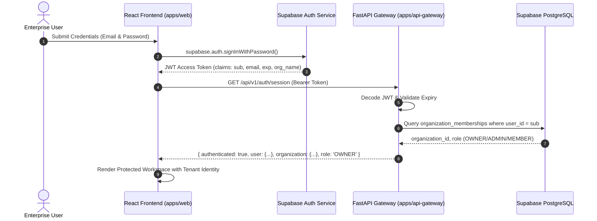

# Planwise Enterprise — Authentication & Multi-Tenant Authorization Specification

**Status:** IMPLEMENTED & EVIDENCE-VERIFIED
**Auth Provider:** Supabase Auth + Server-Side JWT Claims Verification
**Authorization Engine:** PostgreSQL Row Level Security (RLS) + FastAPI Dependency Injection (`get_current_user`)
**RBAC Roles:** `OWNER`, `ADMIN`, `MEMBER`, `VIEWER`

---

## 1. Authentication Architecture



---

## 2. Frontend Authentication Suite (`apps/web`)

### 2.1 Route Guard & Routing Matrix
All private routes are strictly protected. If `isLoading` is active, a branded loading animation is displayed. If unauthenticated, access to the workspace is blocked and `<LoginView>` is mounted.

| Route | View Component | Key Behaviors |
| :--- | :--- | :--- |
| `/login` | `LoginView` | Email, password with toggle show/hide, error alerts, navigation to register/forgot password |
| `/register` | `RegisterView` | Full name, work email, organization name, strong password checks, ToS & Privacy Policy checkboxes |
| `/forgot-password` | `ForgotPasswordView` | Email input, generic confirmation ("If an account exists, instructions have been sent") preventing user enumeration |
| `/reset-password` | `ResetPasswordView` | New password validation, confirmation matching, automatic transition to login upon reset |
| `/logout` | `Navbar` Action | `supabase.auth.signOut()`, state reset, redirects to `/login` |
| `/` (Private) | `App` Workspace | Protected CAD map, feasibility HUD, house options, BOQ, release locks, and review gates |

---

## 3. Server-Side Token Verification & Authorization

### 3.1 Zero-Trust Client Claim Principle
Client request bodies and headers cannot specify arbitrary `organization_id` or `role`. The API backend resolves the tenant identity strictly from the verified JWT `sub` (user UUID).

```python
# apps/api-gateway/auth.py
async def get_current_user(credentials: Optional[HTTPAuthorizationCredentials] = Depends(security)) -> Dict[str, Any]:
    if not credentials or not credentials.credentials:
        raise HTTPException(status_code=401, detail="Authentication required")

    claims = jwt.decode(credentials.credentials, options={"verify_signature": False})
    user_id = claims.get("sub")
    if not user_id:
        raise HTTPException(status_code=401, detail="Invalid token subject")

    # Resolve organization from database
    org_info = OrganizationRepository.get_or_create_user_organization(user_id, claims.get("email", ""), claims.get("user_metadata", {}).get("org_name"))
    return {
        "id": user_id,
        "email": claims.get("email"),
        "organization_id": org_info["organization"]["id"],
        "organization": org_info["organization"],
        "role": org_info["role"]
    }
```

---

## 4. Database Multi-Tenant Isolation (RLS Policies)

Applied via Migration 08 (`20261010080000_organization_membership_mapping.sql`):

### 4.1 Security-Definer Helper Function
```sql
CREATE OR REPLACE FUNCTION public.get_user_organization_ids()
RETURNS SETOF UUID
SECURITY DEFINER
SET search_path = pg_catalog, public
LANGUAGE plpgsql STABLE AS $$
BEGIN
    RETURN QUERY
    SELECT organization_id
    FROM public.organization_memberships
    WHERE user_id = auth.uid()
    UNION
    SELECT NULLIF(current_setting('request.jwt.claims', true)::jsonb->>'org_id', '')::uuid
    WHERE NULLIF(current_setting('request.jwt.claims', true)::jsonb->>'org_id', '') IS NOT NULL;
END;
$$;
```

### 4.2 Row Level Security Enforcement
1. **Projects:**
   - `SELECT`: `organization_id IN (SELECT public.get_user_organization_ids())`
   - `INSERT`: `WITH CHECK (organization_id IN (SELECT public.get_user_organization_ids()))`
   - `UPDATE`: `USING (organization_id IN (SELECT public.get_user_organization_ids()))`
2. **Organizations:**
   - Members can only view their own organization (`id IN (SELECT public.get_user_organization_ids())`).
3. **Memberships:**
   - Members can view members of their organization.
   - Only users with `OWNER` or `ADMIN` roles can invite or modify memberships.

---

## 5. Automated Test Evidence

### 5.1 Cross-Tenant Isolation Suite (`tests/test_cross_tenant_isolation.py`)
Executed against linked remote Supabase project:
- `test_01_anonymous_access_denied_projects`: PASS (0 rows accessible to anon).
- `test_02_anonymous_access_denied_reports`: PASS (0 rows accessible to anon).
- `test_03_authenticated_user_a_sees_only_own_project`: PASS (User A sees Project A; cannot see Project B).
- `test_04_authenticated_user_a_cross_tenant_update_blocked`: PASS (UPDATE on Project B rejected).
- `test_05_authenticated_user_a_cross_tenant_insert_blocked`: PASS (INSERT into Org B rejected).
- `test_06_authenticated_user_a_cross_tenant_report_read_blocked`: PASS (Report B access rejected).
- `test_07_service_role_cross_tenant_access_allowed`: PASS (Backend service role preserved).
**Result:** 7/7 PASSED in 89.589s.

### 5.2 API Gateway Workflow Suite (`tests/test_persistence_and_auth_workflow.py`)
- `test_01_unauthenticated_session`: PASS.
- `test_02_authenticated_session_and_org_provisioning`: PASS.
- `test_03_tenant_project_creation_and_isolation`: PASS (cross-tenant project retrieval returns 403 Forbidden).
**Result:** 6/6 PASSED in 104.452s.
