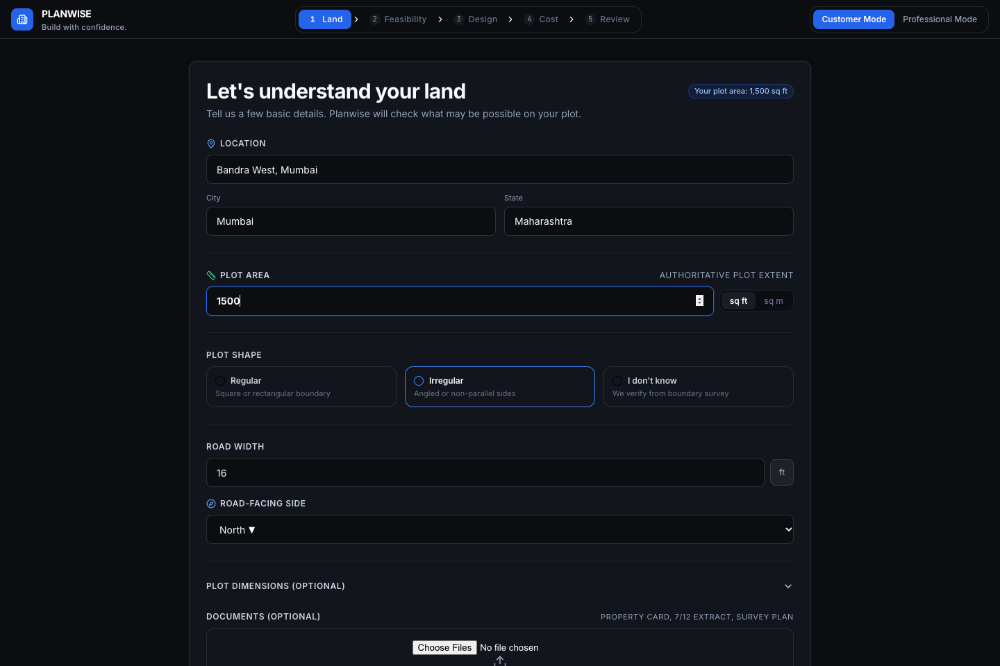
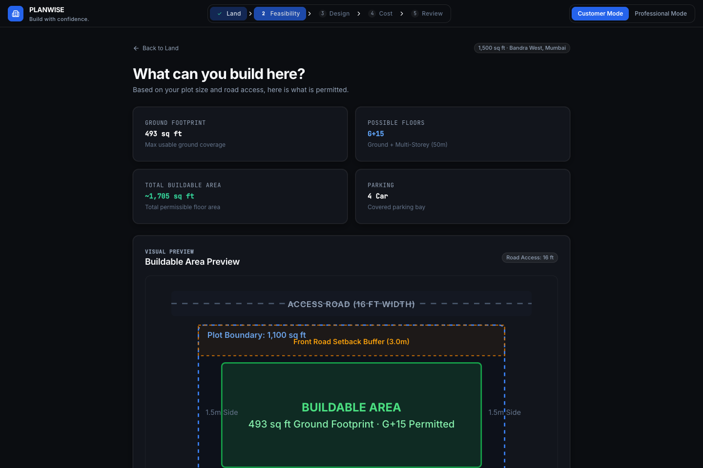
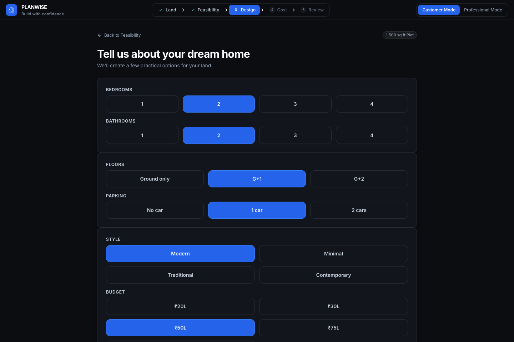
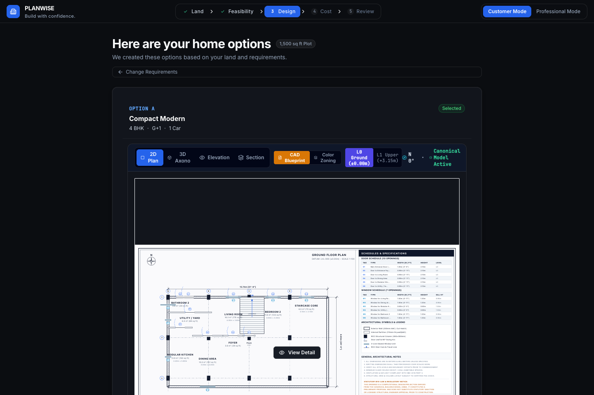
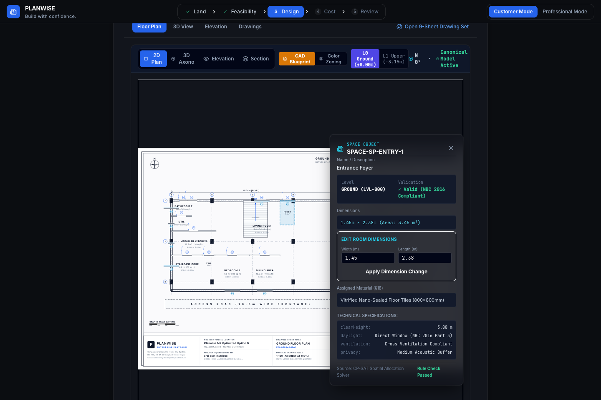
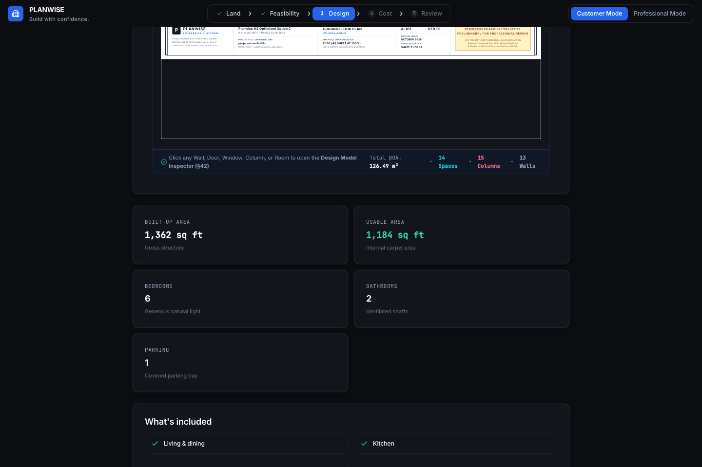
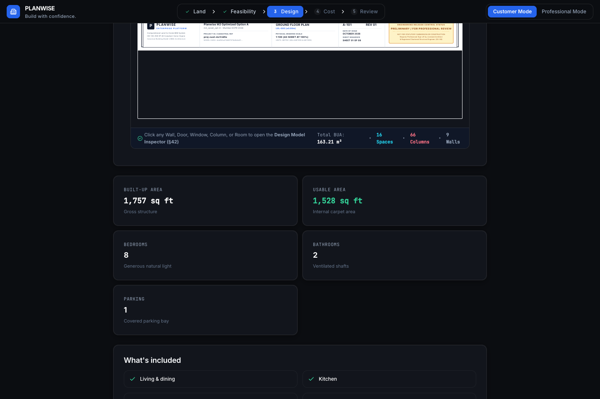
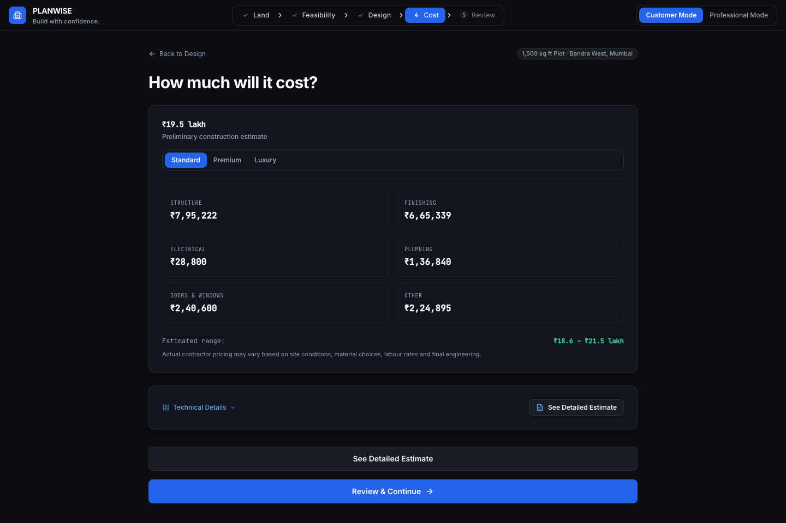
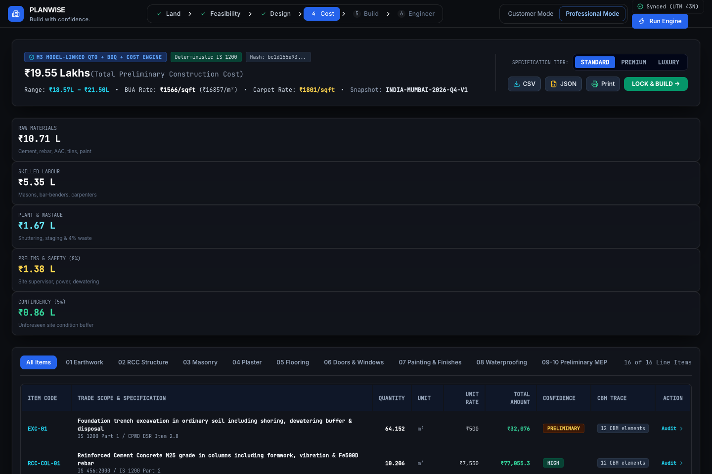

# PLANWISE ENTERPRISE — STEP-BY-STEP USER GUIDE
**Product Version:** 2.0.0-Enterprise
**Document Classification:** Customer & Engineering User Manual
**Publication Date:** October 2026
**Audience:** Property Owners, Real Estate Developers, Design Managers, Civil Engineers & CAD Professionals

---

## LEGAL & STATUTORY NOTICE
> **IMPORTANT NOTICE:**
> Planwise Enterprise is a computational land-to-home development platform that connects land constraints, statutory feasibility, architectural building design, quantity takeoffs, cost estimation, and controlled engineering handoff through a Canonical Building Model (CBM).
> **Planwise outputs support preliminary planning, feasibility analysis, and computational design synthesis. They do NOT constitute statutory municipal sanctions, structural engineering certifications, licensed architectural sign-offs, or authorization to commence construction.**
> All generated designs, structural elements, and quantity takeoffs must be reviewed, sealed, and submitted by a licensed Architect registered with the Council of Architecture (COA), a licensed Structural Engineer, and relevant municipal authorities (e.g., MCGM / BBMP) prior to physical execution.

---

## TABLE OF CONTENTS
1. [Chapter 1: Introduction to Planwise Enterprise](#chapter-1-introduction-to-planwise-enterprise)
2. [Chapter 2: Getting Started & System Navigation](#chapter-2-getting-started--system-navigation)
3. [Chapter 3: Creating a Land Project (Step 1: LAND)](#chapter-3-creating-a-land-project-step-1-land)
4. [Chapter 4: Site Evidence & Statutory Feasibility (Step 2: FEASIBILITY)](#chapter-4-site-evidence--statutory-feasibility-step-2-feasibility)
5. [Chapter 5: Entering the Customer Design Brief (Step 3: DESIGN — Intake)](#chapter-5-entering-the-customer-design-brief-step-3-design--intake)
6. [Chapter 6: Generating & Comparing Design Options (Step 3: DESIGN — Options)](#chapter-6-generating--comparing-design-options-step-3-design--options)
7. [Chapter 7: Reading Architectural Floor Plans (Step 3: DESIGN — Blueprint Viewer)](#chapter-7-reading-architectural-floor-plans-step-3-design--blueprint-viewer)
8. [Chapter 8: Quantity Takeoff, BOQ & Cost Estimation (Step 4: COST)](#chapter-8-quantity-takeoff-boq--cost-estimation-step-4-cost)
9. [Chapter 9: Build Review, Release Locking & Handoff Packages (Step 5: BUILD)](#chapter-9-build-review-release-locking--handoff-packages-step-5-build)
10. [Chapter 10: Professional Engineer Review & Approval Gates (Step 6: ENGINEER)](#chapter-10-professional-engineer-review--approval-gates-step-6-engineer)
11. [Chapter 11: Practical Troubleshooting Guide](#chapter-11-practical-troubleshooting-guide)
12. [Chapter 12: System Limitations & Safe Use Boundaries](#chapter-12-system-limitations--safe-use-boundaries)

---

## CHAPTER 1: INTRODUCTION TO PLANWISE ENTERPRISE

### 1.1 What Planwise Enterprise Does
Planwise Enterprise is an end-to-end computational building platform that replaces disconnected manual steps—such as boundary surveys, zoning checks, floor planning, material takeoffs, and contractor estimates—with an integrated, mathematically verifiable workflow.

Using a single **Canonical Building Model (CBM)**, the platform coordinates:
- **Land Boundary Ingestion:** Converts geodetic GPS or manual plot dimensions into a local Site Engineering Coordinate System (SECS) with zero Web Mercator distortion.
- **Automated Statutory Feasibility:** Applies municipal building bye-laws (e.g., Greater Mumbai DCPR 2034 or Bengaluru BBMP 2026) to compute road widening deductions, directional setbacks, buildable footprint boundaries, Floor Space Index (FSI), and maximum building heights.
- **Constraint Programming Floor Plan Synthesis:** Uses Google OR-Tools CP-SAT to mathematically optimize room layouts against Indian National Building Code (NBC 2016) room dimensions, daylighting requirements, and forbidden adjacencies.
- **IS 1200 Quantity Takeoffs (QTO):** Computes net masonry, concrete, plaster, tiling, and joinery quantities directly from 3D solid geometries, deducting door, window, and shaft voids.
- **Deterministic Cost Waterfalls:** Computes itemized construction bills of quantities (BOQ) using CPWD-aligned regional rate catalogs.
- **Controlled Engineering Handoff:** Packages verified designs into buildingSMART IFC4 models, high-precision SVG vector drawings, and engineering review dossiers.

### 1.2 Who Should Use Planwise
- **Property Owners & Private Homebuilders:** To test what house typologies fit their land, understand municipal setback rules, and obtain a realistic turnkey cost estimate.
- **Real Estate Developers:** To evaluate plot yields, compare single-family vs duplex options, and accelerate feasibility studies from weeks to seconds.
- **Design Managers & Project Architects:** To rapidly generate compliant layout options and inspect underlying metric parameters.
- **Civil Engineers & Quantity Surveyors:** To verify itemized quantities, audit opening deductions, and review approval gates before construction release.

### 1.3 What Planwise Needs as Inputs
1. **Plot Location & Boundary:** Declared plot area in square feet or meters, plus parcel boundary coordinates.
2. **Access Road Parameters:** Existing road width and proposed statutory master plan road width.
3. **Customer Building Requirements:** Number of bedrooms, bathrooms, floors, and preferred architectural style.

### 1.4 What Planwise Produces as Outputs
1. **Authoritative Feasibility Dossier:** Permissible BUA, carpet area, ground coverage, and setback dimensions.
2. **Architectural Blueprint Floor Plans:** Millimeter-accurate SVG drawings with walls, doors with swing arcs, windows, staircases, dimension strings, and room labels.
3. **Itemized Bill of Quantities (BOQ):** Net quantities structured by CPWD trade codes adhering to IS 1200.
4. **Transparent Cost Waterfall:** Direct hard cost, contractor prelims (8%), physical contingency (5%), and statutory GST (18%).
5. **Open BIM Deliverables:** buildingSMART IFC4 model with georeferenced EPSG:4326 metadata.

---

## CHAPTER 2: GETTING STARTED & SYSTEM NAVIGATION

### 2.1 Accessing the Application
In the current prototype release, Planwise Enterprise runs as a local web service:
- **Frontend URL:** `http://localhost:5173`
- **Backend API Gateway:** `http://localhost:5001/api/v1`

When you open `http://localhost:5173` in Google Chrome or any modern Chromium browser, the application loads immediately into your active project workspace.

> **Note on Authentication:** User registration, passwords, and multi-tenant organization sign-in are **not implemented** in the current prototype. The application runs in an open single-tenant local session. All team members sharing the same local instance share the current project state.

### 2.2 System Navigation & Header Layout
The top navigation bar contains all primary navigation and operational controls:

```
[ PLANWISE ENTERPRISE ]  |  (1) LAND  ->  (2) FEASIBILITY  ->  (3) DESIGN  ->  (4) COST  ->  (5) BUILD  ->  (6) ENGINEER  |  [Customer | Technical]  [My Project]
```

1. **Brand & Version Indicator:** Displays `PLANWISE` with the `ENTERPRISE` badge.
2. **Workflow Progression Tabs:**
   - **Step 1: LAND** — Enter plot location, declared area, road access, or boundary geometry.
   - **Step 2: FEASIBILITY** — Review statutory setbacks, road widening deductions, and buildable footprint.
   - **Step 3: DESIGN** — Enter your room brief, synthesize layouts, and inspect CAD floor plans.
   - **Step 4: COST** — Review the turnkey cost waterfall, switch quality tiers, and inspect the BOQ.
   - **Step 5: BUILD** — Confirm customer acknowledgements, lock the build release, and prepare handoff.
   - **Step 6: ENGINEER** — Inspect professional verification gates G0–G6, review issues, and sign the digital stamp.
3. **View Mode Switcher:**
   - **CUSTOMER Mode (Default):** Streamlined, high-level cards, visual sliders, and intuitive summaries tailored for property owners and commercial clients.
   - **TECHNICAL Mode:** Dense engineering HUDs, Mapbox spatial tools, interactive polygon nodes, CAD layer controls, and raw regulatory citations.
4. **My Project Button:** Opens the project status modal showing declared area, cadastral survey numbers, and current workflow progress.
5. **System Status Indicators:** Visual badges indicate background auto-save status (`Saved` / `Saving...`), calculation state (`Running Feasibility...`), and release lock status.

---

## CHAPTER 3: CREATING A LAND PROJECT (STEP 1: LAND)

The first step in any Planwise project is defining the site parcel.


*Figure 3.1: Land Intake Screen (Customer Mode) showing project location, declared area of 1,500 sq ft, road access widths, and plot shape inputs.*

### 3.1 Form-Based Land Intake (Customer Mode)
When in **CUSTOMER** mode, the screen presents an intuitive property input form:
1. **Property Location / Address:** Enter your site address (e.g., `Bandra West, Mumbai`).
2. **City, State & Jurisdiction:** Select the municipal jurisdiction (defaults to `MUMBAI_DCPR_2034` or `BBMP_BENGALURU_2026`).
3. **Declared Plot Area:** Enter your registered plot area (e.g., `1500`) and choose the unit (`sq ft` or `sq m`).
4. **Plot Geometry Shape:**
   - **Regular (Rectangular / Square):** The engine synthesizes an optimal 16:9 rectangular envelope.
   - **Irregular:** The engine prompts for individual boundary coordinate points.
5. **Existing Road Width:** Enter the current road width in feet or meters (e.g., `16 ft` / `4.88 m`).
6. **Proposed Master Plan Road Width:** Enter statutory road expansion width (e.g., `40 ft` / `12.19 m`).
7. **Road-Facing Orientation:** Select which edge faces the primary access road (`North`, `South`, `East`, `West`).

Click **Confirm Land & Run Feasibility** to save the parcel and advance to Step 2.

### 3.2 Interactive Map Canvas (Technical Mode)
Switching to **TECHNICAL** mode displays the full GIS map canvas powered by Mapbox GL:
- **Click to Add Vertices:** Click on the satellite map to add boundary polygon coordinates. A minimum of 3 vertices is required to form a closed parcel.
- **Drag Vertices:** Click and drag any existing coordinate node to adjust boundary lines.
- **Road Width Controls:** Use the interactive sliders on the map HUD to adjust existing and proposed road widths in real time.
- **Auto-Save Mechanism:** The map includes an automatic 600ms debounced save mechanism. Any modification is sent to `PUT /api/v1/projects/{id}/geometries` without requiring manual page reloads.

### 3.3 Understanding Area Definitions
To prevent costly misunderstandings, Planwise strictly differentiates four area metrics:
1. **Declared Plot Area ($A_{\text{declared}}$):** The gross area stated on your title deed or sale deed (e.g., 1,500 sq ft = $139.35\text{ m}^2$).
2. **Statutory Surrender Area ($A_{\text{widening}}$):** Land surrendered to the municipal authority along the road frontage for master plan road widening.
3. **Net Developable Area ($A_{\text{net}}$):** $A_{\text{declared}} - A_{\text{widening}}$. This is the statutory base used for calculating Floor Space Index (FSI).
4. **Buildable Footprint Area ($A_{\text{buildable}}$):** The physical polygon remaining inside the plot after deducting mandatory front, rear, and side setbacks.

---

## CHAPTER 4: SITE EVIDENCE & STATUTORY FEASIBILITY (STEP 2: FEASIBILITY)

Once your land boundary is defined, Planwise runs an automated statutory feasibility check.


*Figure 4.1: Feasibility Summary Screen displaying statutory compliance prognosis, road widening surrender, directional setbacks, and permissible BUA.*

### 4.1 Reviewing the Feasibility Summary
The Feasibility Summary card displays the automated regulatory assessment:
- **Statutory Feasibility Status:** Displays `FEASIBLE` (green badge) if the parcel accommodates residential construction, or `BLOCKED / INFEASIBLE` if statutory constraints prevent building.
- **Statutory Authority:** Cites the governing development code (e.g., *Municipal Corporation of Greater Mumbai — DCPR 2034*).
- **Road Widening Surrender:** Shows the surrendered strip depth and area.
  $$\Delta w = \max\left(0, \frac{W_{\text{proposed}} - W_{\text{existing}}}{2}\right)$$
  For an existing road of 6m expanding to 12m, a $3.0\text{m}$ strip is deducted along the front boundary.
- **Directional Building Setbacks:**
  - **Front Marginal Open Space:** Required clearance between the road boundary and the building facade (e.g., $4.5\text{m}$ for standard residential roads).
  - **Rear Open Space:** Buffer at the rear of the plot (statutory $3.0\text{m}$).
  - **Side Open Spaces:** Lateral side clearances (statutory $1.5\text{m}$ each).
- **Buildable Envelope Area:** The exact net rectangular or polygon footprint area available for construction.
- **Permissible Built-Up Area (BUA):** The total allowable constructed floor area across all storeys:
  $$A_{\text{BUA}} = A_{\text{net}} \times (\text{FSI}_{\text{base}} + \text{FSI}_{\text{premium}} + \text{FSI}_{\text{tdr}})$$
- **Usable Carpet Area Estimate:** Estimated usable internal floor area (calculated at $70\%$ of permissible BUA per RERA definitions).
- **Maximum Permissible Height:** Statutory height cap based on road width (e.g., $16.0\text{m}$ to $32.0\text{m}$).

### 4.2 Site Evidence & Confidence Levels (L0 to L3)
In the top-right corner of the screen, the **Site Evidence & Truth Panel** displays the parcel's verification confidence level:

| Level | Evidence Category | Data Provenance | Permitted Platform Operations | Release Gating Status |
|---|---|---|---|---|
| **L0** | Unverified Declaration | User typed area without spatial coordinates. | Desktop feasibility and rough estimates only. | **BLOCKED:** Cannot lock build release. |
| **L1** | Desktop Geometry | Approximate boundary drawn on satellite canvas ($\pm 2.5\text{m}$ error). | Preliminary layout generation and exploration. | **BLOCKED:** Cannot lock build release. |
| **L2** | Municipal GIS Cadastral | Official municipal vector shapefile (e.g., MCGM CTS cadastral survey). | Statutory feasibility and sanction application reviews. | **CONDITIONAL:** Requires boundary verification. |
| **L3** | Licensed Land Survey | Total Station / RTK-GNSS licensed land surveyor boundary with physical monuments. | Construction Releases, G6 Build Lock, IFC Handoff. | **UNLOCKED:** Authorized for construction release. |

Click **Proceed to Step 3: DESIGN** to begin synthesizing floor plans.

---

## CHAPTER 5: ENTERING THE CUSTOMER DESIGN BRIEF (STEP 3: DESIGN — INTAKE)

In Step 3, you translate your living requirements into an architectural room program.


*Figure 5.1: Customer Design Intake Screen showing configuration options for bedrooms, bathrooms, floor levels, and architectural styles.*

### 5.1 Configuring Your Living Requirements
The Design Intake screen provides interactive controls for your house brief:
1. **Bedrooms (BHK):** Choose from `1 BHK`, `2 BHK`, `3 BHK`, `4 BHK`, or `5+ BHK`.
2. **Bathrooms:** Select `1 Bath`, `2 Baths`, `3 Baths`, or `4+ Baths`.
3. **Floor Configuration:**
   - **1 Floor (Single Level):** All rooms arranged on the ground floor level (L0).
   - **2 Floors (G+1 Duplex):** Living, kitchen, and guest bedroom on ground floor; master suite and secondary bedrooms on upper level (L1), connected by an internal RCC staircase.
4. **Architectural Style:**
   - **Contemporary:** Open-plan living/dining, large glazed windows, minimalist detailing.
   - **Minimalist:** Compact circulation corridors, efficient modular room proportions.
   - **Traditional:** Defined formal foyer, distinct kitchen compartmentalization.
   - **Modern Indian:** Dedicated prayer/pooja alcove, separate utility/wash yard adjacent to kitchen.
5. **Parking Allocation:** Number of enclosed or stilt car parking spaces (1 to 2 ECS).

Click **Synthesize Architectural Options (CP-SAT)** to run the mathematical layout solver.

---

## CHAPTER 6: GENERATING & COMPARING DESIGN OPTIONS (STEP 3: DESIGN — OPTIONS)

When you submit your design brief, Planwise runs **Google OR-Tools CP-SAT** to synthesize multiple layout options.


*Figure 6.1: Generated Design Options View presenting synthesized Pareto candidate cards with floor plans, area metrics, and estimated costs.*

### 6.1 How Layout Synthesis Works
Unlike AI image generators that create unbuildable illustrations, Planwise uses mathematical constraint programming:
- **100mm Discretization:** Rooms are placed on an exact $100\text{mm}$ ($0.1\text{m}$) coordinate grid.
- **Zero Collision Guarantee:** Every room is modeled as a 2D spatial interval; `AddNoOverlap2D` guarantees that rooms never intersect or overlap.
- **Statutory Room Dimensions:** Every room satisfies Indian NBC 2016 Part 3 minimum areas (e.g., Living $\ge 9.5\text{m}^2$, Master Bed $\ge 9.5\text{m}^2$, Kitchen $\ge 4.5\text{m}^2$, Bath $\ge 1.8\text{m}^2$).
- **Perimeter Daylighting Bonus:** Habitable spaces earn objective rewards when positioned along exterior envelope walls.
- **Wet Area Clustering:** Bathrooms, kitchens, and utilities are mathematically clustered to minimize plumbing stack runs.
- **Pareto Frontier Selection:** The solver generates dozens of candidate layouts and filters them down to the top Pareto-optimal candidates balancing spatial efficiency, daylight access, and circulation.

### 6.2 Comparing Design Candidate Cards
Each option card displays key comparative metrics:
- **Option Badge & Typology:** e.g., `Option A: Balanced Living 3BHK` or `Option B: Compact Efficient 3BHK`.
- **Gross Built-Up Area (BUA):** Total covered construction area (e.g., $139.35\text{ m}^2$ / $1,500\text{ sq ft}$).
- **Usable Carpet Area:** Exact sum of usable interior room polygons (e.g., $105.8\text{ m}^2$ / $1,139\text{ sq ft}$).
- **Spatial Efficiency:** Ratio of usable carpet area to BUA (typically $75\% - 82\%$).
- **Estimated Turnkey Construction Cost:** Computed in real time from the preliminary BOQ (e.g., `₹39.2 Lakhs`).
- **Floor Plan Thumbnail:** Interactive 2D preview of the layout.

Click on any candidate card to select it, or click **Choose This Design & Review Cost** to proceed.

---

## CHAPTER 7: READING ARCHITECTURAL FLOOR PLANS (STEP 3: DESIGN — BLUEPRINT VIEWER)

When an option is selected, the application displays a full architectural CAD blueprint.


*Figure 7.1: Architectural Floor Plan Blueprint showing room layouts, door swing arcs, sliding windows, and dimension strings.*

### 7.1 Graphical CAD Conventions
The vector floor plan conforms to professional architectural drafting standards:
1. **Wall Representations:**
   - **External Perimeter Walls:** Rendered with thick $1.6\text{pt}$ solid black strokes and subtle grey fills, indicating $230\text{mm}$ ($9\text{"}$) load-bearing structural masonry.
   - **Internal Partition Walls:** Rendered with $1.0\text{pt}$ lines, indicating $115\text{mm}$ ($4.5\text{"}$) non-load-bearing AAC blockwork.
2. **Doors & Swing Arcs:** Rendered with a solid door leaf angled at $90^\circ$ and a dashed quarter-circle arc indicating the clear swing clearance.
3. **Architectural Windows:** Rendered as double lines along exterior walls with outer cut lines and inner glass centerlines.
4. **Staircase Elements (for Duplexes):** Rendered with individual parallel tread lines, solid landing dividers, and an arrow indicating ascent with the bold label **"UP"**.
5. **Dimension Strings:** Dimension lines with $45^\circ$ architectural tick marks display both imperial feet-and-inches (e.g., `14'-6"`) and metric millimeters.
6. **Room Labels:** Bold room names (e.g., **MASTER BEDROOM**) accompanied by net carpet area (e.g., `14.2 m²`).

### 7.2 Interactive Room Customization & Dimension Adjustments
Clicking on any room in the floor plan opens the **Room Inspector Panel**:


*Figure 7.2: Interactive Room Dimension Mutation showing live width adjustments and instant area recalculations.*

- **Width & Depth Controls:** Use the dimension adjustment buttons ($+0.2\text{m}$, $-0.2\text{m}$) to fine-tune room sizes.
- **Live Re-validation:** The system automatically checks whether modified room dimensions satisfy NBC minimums.
- **Instant Cost Updating:** Adjusting room boundaries instantly recalculates wall lengths, floor tiling areas, and the cost estimate.

### 7.3 Multi-Plot Scalability Verification
Planwise dynamically synthesizes layouts across all plot sizes without template stretching:

```
+--------------------------------------------------------------------------------------------------+
|                                  CANONICAL PLOT SCALE COMPARISON                                 |
+--------------------------------------------------------------------------------------------------+
| Plot Size    | Envelope (W x L)   | Typology              | Room Program                         |
|--------------+--------------------+-----------------------+--------------------------------------|
| 1,100 sq ft  | 13.48m x  7.58m    | 2BHK Single Level     | Living, Master Bed, Bed 2, Kit, 2 Bath|
| 1,500 sq ft  | 15.74m x  8.85m    | 3BHK Single Level     | Living, Dining, 3 Beds, Kit, 2 Baths |
| 2,400 sq ft  | 19.91m x 11.20m    | 4BHK G+1 Duplex       | Living, Dining, 4 Beds, 3 Baths, Stair|
| 10,000 sq ft | 40.64m x 22.86m    | Luxury Estate Villa   | Grand Living, 5 Suites, Courtyard     |
+--------------------------------------------------------------------------------------------------+
```


*Figure 7.3: 2,400 sq ft Duplex Layout showing ground-level master suite, family living, and integrated staircase.*


*Figure 7.4: 10,000 sq ft Estate Villa Layout showing expansive double-height living spaces and courtyard zoning.*

---

## CHAPTER 8: QUANTITY TAKEOFF, BOQ & COST ESTIMATION (STEP 4: COST)

In Step 4, Planwise translates your 3D building geometry into an itemized construction budget.


*Figure 8.1: Cost Summary Screen showing turnkey construction estimate, cost per sq ft BUA, quality tiers, and financial waterfall.*

### 8.1 How Quantities are Measured (IS 1200 Standards)
Unlike rough contractor thumb-rules, Planwise extracts quantities directly from model solid geometries adhering strictly to **IS 1200: Indian Standard Method of Measurement of Building Works**:
1. **IS 1200 Part 3 (Brickwork & Masonry):** Computes gross wall volumes ($L \times H \times T$) and deducts door and window openings exceeding $0.1\text{m}^2$.
2. **IS 1200 Part 2 (Concrete):** Computes structural column volumes ($W \times D \times H$) and slab volumes, deducting stairwells and shaft cutouts exceeding $0.1\text{m}^2$.
3. **IS 1200 Part 12 (Plastering):** Measures internal wall faces (1 face for external walls, 2 faces for internal partitions) and ceiling soffits, deducting openings exceeding $0.5\text{m}^2$ with jamb allowances.
4. **IS 1200 Part 11 (Flooring & Skirting):** Measures clear room carpet areas for tiling, and perimeters minus doorway widths for skirting.

### 8.2 The Turnkey Cost Waterfall
The cost calculation follows a transparent mathematical waterfall:

```
[ Direct Gross Hard Construction Cost (Sum of BOQ Lines) ]
                       |
                       +---> + 8.0% Contractor Prelims & Site Overheads
                       |
                       +---> + 5.0% Physical Contingency Buffer
                       |
            [ Construction Subtotal ]
                       |
                       +---> + 18.0% Statutory Goods & Services Tax (GST)
                       |
         [ TOTAL TURNKEY ESTIMATED CONSTRUCTION COST ]
```

*Example for 1,500 sq ft Residential Project (Standard Quality Tier):*
- **Direct Hard Construction Cost:** ₹31,45,200.00
- **Contractor Prelims & Site Overheads (8%):** ₹2,51,616.00
- **Physical Contingency Buffer (5%):** ₹1,57,260.00
- **Construction Subtotal:** ₹35,54,076.00
- **Statutory GST (18% on Subtotal):** ₹6,39,733.68
- **Total Estimated Turnkey Cost:** **₹41,93,809.68**
- **Cost per Sq Ft BUA:** **₹2,795.87 / sq ft**

### 8.3 Quality Tier Switching
You can toggle between four standardized construction quality tiers:
- **ECONOMY:** Country brick masonry, vitrified tiles ($600\times 600\text{mm}$), standard flush doors, commercial plumbing fittings (~₹2,350 / sq ft BUA).
- **STANDARD (Default):** AAC blockwork, nano-polished vitrified tiles ($800\times 800\text{mm}$), UPVC sliding windows, premium CPVC plumbing (~₹2,795 / sq ft BUA).
- **PREMIUM:** Italian composite marble in living spaces, teakwood main door frame, double-glazed thermal windows (~₹3,450 / sq ft BUA).
- **LUXURY:** Imported marble, concealed VRV air conditioning, automated smart home electricals (~₹4,200 / sq ft BUA).

Click **Proceed to Step 5: BUILD** to prepare for project release.

---

## CHAPTER 9: BUILD REVIEW, RELEASE LOCKING & HANDOFF PACKAGES (STEP 5: BUILD)

In Step 5, you prepare the approved design for construction release and handoff.


*Figure 9.1: Build Review Screen displaying customer acknowledgements, release gating summary, and build confirmation controls.*

### 9.1 Customer Acknowledgements & Build Lock
Before a design can transition to a locked release baseline, the user must review and acknowledge three statutory statements:
1. `[x]` *I understand that soil bearing capacity and foundation design require a site-specific geotechnical borehole test.*
2. `[x]` *I acknowledge that architectural drawings must be sanctioned by the local municipal corporation prior to construction.*
3. `[x]` *I confirm that the selected quality tier and preliminary budget reflect my requested specifications.*

Click **Lock Build Release (G6 Release Gate)** to freeze the design baseline.

### 9.2 The Release Handoff Package
Locking the build executes a deterministic cryptographic freeze:
- **Release ID:** Assigns an immutable release identifier (e.g., `rel-pilot-20261002-aedf9830`).
- **Cryptographic Fingerprint:** Generates a 64-character SHA-256 hash over the entire building model geometry, rates, and quantities. Any subsequent edit generates a new design version, preventing silent tampering.
- **Handoff Package Contents:**
  - `model_cbm.json` — The complete Canonical Building Model definition.
  - `model_ifc4.ifc` — buildingSMART IFC4 architectural model with georeferenced metadata.
  - `floor_plan_ground.svg` — Millimeter-accurate vector CAD floor plan drawing.
  - `bill_of_quantities.csv` & `.json` — Itemized IS 1200 trade quantities and unit rates.
  - `cost_waterfall_summary.pdf` — Turnkey financial breakdown.
  - `validation_report.json` — Manifold3D watertightness and regulatory compliance logs.

---

## CHAPTER 10: PROFESSIONAL ENGINEER REVIEW & APPROVAL GATES (STEP 6: ENGINEER)

Step 6 provides an auditable review interface for licensed structural engineers and architects.


*Figure 10.1: Professional Engineer Review Dashboard showing the G0–G6 verification gates, issue tracker, digital stamp, and export actions.*

### 10.1 Understanding Verification Gates G0–G6
The platform enforces seven sequential verification gates:

```
[ G0: SITE TRUTH ] ---> [ G1: STRUCTURAL ] ---> [ G2: ARCHITECTURAL ]
           |
           v
[ G3: MEP INTEGRITY ] -> [ G4: STATUTORY ] ---> [ G5: COST ACCURACY ]
           |
           v
[ G6: CONSTRUCTION RELEASE LOCK ]
```

1. **G0 — Site Truth Gate:** Verifies boundary coordinates against survey evidence. Rejects unverified L0/L1 parcels from construction handoff.
2. **G1 — Structural Integrity Gate:** Verifies Manifold3D watertight 2-manifold solid geometry ($\text{Volume} > 0$, $\text{Errors} = 0$) and column alignment.
3. **G2 — Architectural Compliance Gate:** Verifies NBC 2016 room dimensions, ceiling heights, and door clearances.
4. **G3 — MEP Infrastructure Gate:** Verifies preliminary electrical fixture counts and wet stack vertical alignments.
5. **G4 — Statutory Bye-Law Gate:** Verifies municipal setback clearances, road widening surrender, and FSI caps.
6. **G5 — Cost & BOQ Audit Gate:** Verifies that all BOQ line items map to verified CBM element IDs.
7. **G6 — Construction Build Lock Gate:** Final authorization gating production drawing issuance and IFC export.

### 10.2 Recording Decisions & Digital Stamp Signing
- **Review Issues:** Engineers can inspect open issues (e.g., `WAR-GEO-001: Geotechnical investigation required`).
- **Override Permissions:** Senior review engineers can record justification notes to override non-critical warnings.
- **Digital Stamp Signing:** Entering a licensed professional registration number (e.g., `PE-STR-MUM-48291`) applies a cryptographic digital signature seal to all exported drawing sheets and reports.

### 10.3 Exporting Project Documents
From the Engineer Dashboard, users can download all official project documents:
- **Download A3 Drawing Sheets (PDF):** Opens the `DrawingSheetsModal` to download architectural drawings (Title Sheet, Site Plan, Ground Floor Plan, Terrace Plan, Sections, and Schedules).
- **Download Customer Home Report (PDF):** Generates a customer-facing 15-page project summary report.
- **Export IFC4 Model:** Downloads the open-standard BIM model for import into Revit, ArchiCAD, or Solibri.
- **Export BOQ Spreadsheet (CSV):** Downloads itemized quantities for tender packaging.

---

## CHAPTER 11: PRACTICAL TROUBLESHOOTING GUIDE

| Issue / Symptom | Likely Cause | Recommended Safe Action | When to Escalate |
|---|---|---|---|
| **"Infeasible Setback Collapse" error on Feasibility** | The plot area is too small or setbacks exceed plot width, leaving $< 10\text{ m}^2$ buildable area. | Verify road widths. If road width was entered too high, reduce to actual measured access road. | If plot is genuinely narrow, escalate to an architect for composite setback variances. |
| **"Road Widening Strip Consumes Entire Plot"** | Proposed road width was entered incorrectly (e.g., $30\text{m}$ instead of $12\text{m}$). | Check your city master plan road width. Update road width in Step 1. | If statutory line of widening is contested, verify with municipal development plan remarks. |
| **CP-SAT Layout Generation Times Out ($> 10\text{s}$)** | The room brief requested too many rooms for the available buildable footprint (e.g., 5 BHK in 600 sq ft). | Reduce bedroom count or floor area, or change floor configuration to `2 Floors (G+1 Duplex)`. | If solver fails repeatedly on valid plots, check backend API gateway logs. |
| **"Cannot Lock Build: Release Gated by Site Evidence"** | The project is at site confidence level L0 or L1. The system blocks construction releases without survey verification. | Upload a Total Station land survey or municipal CTS cadastral vector in the Site Evidence Panel. | Escalate to licensed land surveyor to conduct on-site monument survey. |
| **Doorway Opens Across Room Boundary** | Room dimensions were manually mutated beyond host wall extent. | Click **Reset Layout** in Floor Plan Viewer to restore the solver's optimal placement. | If reset fails, re-generate options from Step 3. |
| **Cost Estimate Displays "₹0.00" or Fails to Load** | Rate snapshot was not loaded or model lacks compiled CBM elements. | Click **Retry** on the Cost Summary card. Verify network connection to API gateway. | If rates remain empty, restart local backend service (`apps/api-gateway`). |
| **3D Solid View Shows Missing Walls** | Browser WebGL context was lost or Manifold3D library is compiling. | Refresh page or toggle the **3D Solid** button in the CAD toolbar. | Ensure Google Chrome hardware acceleration is enabled in browser settings. |
| **IFC Export Fails or File is 0 Bytes** | Disk permissions error in local `artifacts/` folder. | Verify local disk write permissions in the workspace directory. | Escalate to system administrator. |
| **Changes to Declared Area Do Not Reflect in Design** | Cached browser session holding previous design version. | Click **My Project** -> **Clear & Start Fresh**, then re-enter the declared plot area. | Ensure API gateway is running and not returning 304 Not Modified. |
| **Browser Shows "API Connection Failed / Offline"** | Backend FastAPI server on port 5001 is stopped. | Run `uvicorn apps.api_gateway.main:app --port 5001` in your terminal workspace. | Verify port 5001 is not blocked by a local firewall. |

---

## CHAPTER 12: SYSTEM LIMITATIONS & SAFE USE BOUNDARIES

To ensure safe, ethical, and legally compliant use, Planwise Enterprise discloses the following operational boundaries:

### 12.1 Security & Multi-Tenancy Prototype Status
- **PostgreSQL Row-Level Security (RLS):** Not active in the current prototype. The application runs as a local single-tenant workspace. Do not deploy to an untrusted public network without adding authentication middleware.
- **Session Isolation:** Projects are stored in an in-memory application cache. Clearing the server restarts the baseline project state.

### 12.2 Architectural & Engineering Scope Limits
- **Multi-Floor Generation:** The CP-SAT solver optimizes ground floor layouts directly; upper levels on multi-storey duplexes are generated sequentially using staircase core alignment.
- **Structural Finite Element Analysis (FEA):** The platform places structural RCC columns along standard room intersections. It does **not** perform 3D structural frame analysis, wind load calculations, or seismic zone moment distribution. A licensed Structural Engineer must size all reinforcement rebar and footing dimensions.
- **Dynamic MEP Routing:** The system calculates fixture point counts and vertical plumbing stacks; it does not model 3D spatial piping slope or electrical conduit runs.
- **Municipal Sanctions:** Planwise generates compliance dossiers, but does **not** connect automatically to municipal sanction portals (e.g., MCGM AutoDCR or BBMP Suvarna). Formal submission requires an architect's council registration number.
- **Geotechnical Foundations:** Default foundation excavation depths assume standard empirical soil conditions ($150\text{ kN/m}^2$). Actual footing design requires physical soil borehole testing.

---

## APPENDIX: GLOSSARY OF TERMS

- **BCS (Building Coordinate System):** Local Cartesian coordinate system aligned with the building envelope's southwest corner.
- **BUA (Gross Built-Up Area):** Total constructed floor area measured to the exterior faces of perimeter walls.
- **Carpet Area:** Usable net floor area inside room walls, excluding wall thicknesses and structural shafts (per RERA).
- **CBM (Canonical Building Model):** The centralized, deterministic JSON data model representing the entire building geometry, elements, and metadata.
- **CP-SAT:** Constraint Programming — Satisfiability solver from Google OR-Tools.
- **DCPR 2034:** Development Control and Promotion Regulations 2034 for Greater Mumbai.
- **FSI / FAR:** Floor Space Index / Floor Area Ratio (Total permissible BUA divided by Net plot area).
- **IS 1200:** Bureau of Indian Standards code of practice for measurement of building works.
- **Manifold3D:** High-performance computational geometry kernel guaranteeing watertight 2-manifold 3D solids.
- **NBC 2016:** National Building Code of India 2016.
- **SECS (Site Engineering Coordinate System):** Local topocentric East-North-Up (ENU) tangent plane coordinate system in meters.
- **Shoelace Formula:** Mathematical algorithm (Green's theorem) for computing planar polygon areas from ordered vertices.
