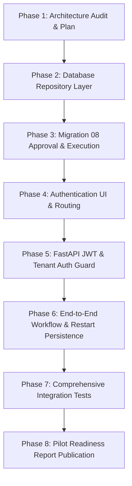

# Planwise Enterprise — Production Persistence, Authentication & Authorization Implementation Plan

## Executive Summary
This document outlines the engineering architecture, database mappings, authentication integration strategy, and security model required to transition Planwise Enterprise from an in-memory/prototype state to a fully authenticated, multi-tenant, PostgreSQL-persisted enterprise platform ready for controlled customer pilots.

---

## 1. Current Architecture & Gap Analysis

### 1.1 Persistence Gaps
- **Projects & Sites**: `PROJECTS_DB` and `SITE_EVIDENCE_DB` in `apps/api-gateway/main.py` currently operate as in-memory Python dictionaries (`Dict[str, Dict[str, Any]]`). If the server restarts or scales, all customer project configurations, parcel coordinates, and site evidence are lost.
- **Feasibility & Rule Traces**: Deterministic DAG results and statutory explainability trees are computed dynamically and stored in ephemeral memory (`FEASIBILITY_EXPLAINABILITY_DB`).
- **Canonical Building Models (CBM)**: Generated building models, levels, spaces, and 3D elements exist only within ephemeral generation caches.
- **Review Ledger**: `ledger_repository.py` already implements PostgreSQL persistence for Releases, Build Requests, Engineer Reviews, and Gates, but `.env` points `DATABASE_URL` to local PostgreSQL (`localhost:5432`) rather than remote Supabase PostgreSQL.

### 1.2 Authentication & Authorization Gaps
- **Missing Auth Layer**: The frontend (`apps/web`) currently lacks login, registration, password recovery, and protected route wrappers.
- **Missing Organization Membership Join**: Migration 07 established RLS, but relies exclusively on JWT claim `org_id`. No relational join between Supabase `auth.users` and tenant `organizations` exists in the database.
- **Role-Based Access Control (RBAC)**: No role model (`OWNER`, `ADMIN`, `MEMBER`, `VIEWER`) is currently enforced at the API or database level.

### 1.3 Networking & Security Gaps
- **Vite Proxy Resolution**: Vite proxy previously targeted `http://localhost:5001`, which Node.js 18+ resolved to IPv6 `::1:5001` (refused by IPv4 Uvicorn). Resolved by binding to `127.0.0.1:5001`.
- **Secret Privacy**: `apps/web/.env` was sanitized to eliminate leaked backend database credentials and passwords.

---

## 2. Table-to-Entity Persistence Mapping

All 34 application tables already created on Supabase will be bound to concrete repository implementations:

| Domain Entity | PostgreSQL Table | Primary Key | Key Foreign Keys & Relationships |
|---|---|---|---|
| **Organizations** | `organizations` *(Migration 08)* | `id UUID` | Root tenant entity. |
| **Memberships** | `organization_memberships` *(Migration 08)* | `id UUID` | `organization_id` -> `organizations(id)`, `user_id` -> `auth.users(id)`. |
| **Projects** | `projects` | `id UUID` | `organization_id UUID` (tenant boundary). |
| **Parcels** | `parcels` | `id UUID` | `project_id` -> `projects(id)` ON DELETE CASCADE. PostGIS geometry. |
| **Parcel Constraints**| `parcel_constraints` | `id UUID` | `parcel_id` -> `parcels(id)` ON DELETE CASCADE. |
| **Feasibility Runs** | `feasibility_runs` | `id UUID` | `project_id` -> `projects(id)`, `parcel_id` -> `parcels(id)`. |
| **Site Reference Frames**| `site_reference_frames` | `id UUID` | `project_id` -> `projects(id)`. |
| **Site Evidence** | `site_evidence` | `id UUID` | `project_id` -> `projects(id)`. Spatial geometry & confidence tier. |
| **Design Versions** | `design_versions` | `id VARCHAR(64)` | `project_id` -> `projects(id)`. |
| **Building Models (CBM)**| `building_models` | `id VARCHAR(64)` | `design_version_id` -> `design_versions(id)`. SHA-256 fingerprint. |
| **Levels & Spaces** | `building_levels`, `spaces` | `id VARCHAR(64)` | `building_model_id` -> `building_models(id)`. Space boundary polygons. |
| **Elements & Openings** | `building_elements`, `openings` | `id VARCHAR(64)` | `building_model_id`, `level_id`, `host_wall_id`. 3D solids & walls. |
| **QTO & BOQ** | `qto_takeoff_records`, `cost_estimates`| `id VARCHAR(64)` | `design_version_id`, `project_id`. |
| **Releases & Reviews**| `releases`, `engineer_reviews`| `id VARCHAR(64)` | `project_id`, `design_version_id`. Frozen fingerprint ledger. |
| **Generated Reports** | `generated_reports` | `id VARCHAR(64)` | `project_id`, `design_version_id`. SHA-256 PDF hashes. |

---

## 3. Authentication & Authorization Strategy

### 3.1 Authentication Architecture
- **Supabase Auth Integration**:
  - The frontend utilizes `@supabase/supabase-js` for user registration, login, email verification, password recovery, and session token renewal.
  - Client state manages user identity, session JWT, active organization, and user role.
- **Backend Verification**:
  - FastAPI implements a security dependency (`get_current_user_and_org`) verifying JWT bearer tokens using `pyjwt` with Supabase JWT Secret or public JWKS.
  - Extracts verified `sub` (`user_id`), `email`, and queries `organization_memberships` for active tenant access.
  - Unauthenticated requests receive HTTP 401 Unauthorized; cross-tenant requests receive HTTP 403 Forbidden.

### 3.2 Required Authentication Screens
1. `/login`: Email + password, show/hide toggle, loading/error states, redirect to dashboard.
2. `/register`: Full name, work email, password confirmation, organization creation, terms acceptance.
3. `/forgot-password`: Rate-limited recovery email dispatcher without user enumeration leak.
4. `/reset-password`: Token/recovery session validator, password update, redirect to login.
5. `Logout`: Session revocation, local storage sanitization, navigation to login.

---

## 4. Implementation Sequence

1. **Step 1**: Complete implementation plan (`PLANWISE_IMPLEMENTATION_PLAN.md`).
2. **Step 2**: Build PostgreSQL repository module (`apps/api-gateway/postgres_repository.py`) covering Projects, Parcels, Site Evidence, Design Versions, and CBM models with full transaction rollback.
3. **Step 3**: Present Migration 08 (`proposed_20261010080000_organization_membership_mapping.sql`) for user approval, and push to Supabase once approved.
4. **Step 4**: Implement React Authentication components in `apps/web/src/components/auth/` and route guards in `App.tsx`.
5. **Step 5**: Implement FastAPI authentication middleware and tenant context dependency in `apps/api-gateway/main.py`.
6. **Step 6**: Execute automated test verification across auth, cross-tenant isolation, process restart persistence, and CBM workflows.
7. **Step 7**: Update pilot readiness documentation and environment templates.

---

## 5. Acceptance Criteria

- [ ] All project, parcel, site, and CBM operations persist to PostgreSQL and survive complete API process restarts.
- [ ] No customer data is stored in ephemeral Python dictionaries.
- [ ] Full login, registration, password recovery, and logout flows operate in the UI.
- [ ] User A in Organization A cannot view, mutate, or access projects or reports belonging to Organization B.
- [ ] Cross-tenant security tests pass on remote Supabase instance.
- [ ] Zero secrets (database passwords, service keys) exposed in frontend bundles or logs.
